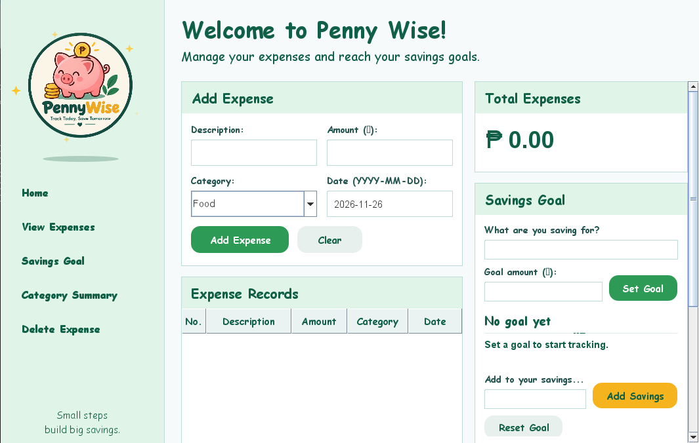
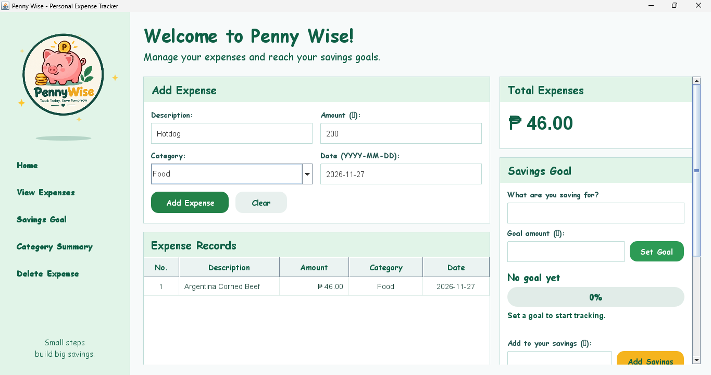
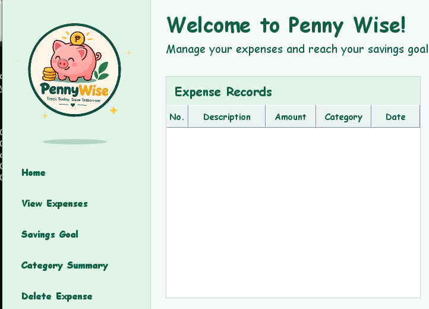
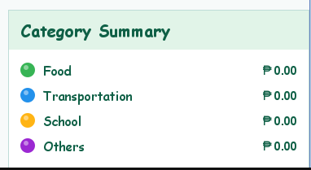
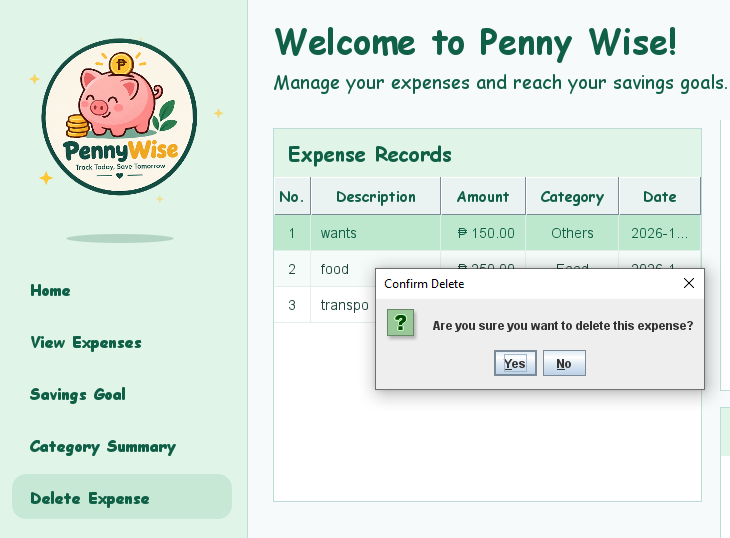
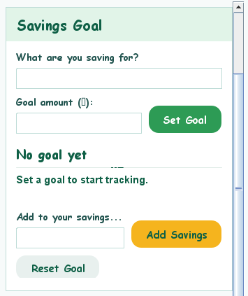

<h1 align="center">PennyWise</h1>


<h3 align="center">A Java-Based Personal Expense Tracker</h3>

<p align="center">
  <b>OOP 101</b><br>
  <b>CS 2101<b><br>
  <b>Group 11 Three Idiots<b><br>
  Perez, Jaspher A<br>
  Perez, Sean Kelvin A.<br>
  Villaverde, John Aaron C.
</p>


---

## Overview

PennyWise is a Java-based Personal Expense Tracker designed to help students and individuals manage and monitor their daily expenses through a simple and user-friendly graphical interface.

The application allows users to record their expenses, organize them into different categories, calculate their total spending, and review their expense records. Through its dashboard, PennyWise provides an accessible way for users to monitor their spending habits and become more aware of their daily financial activities.

## Problem Description

Students and individuals often experience difficulties managing their daily expenses, especially when they do not have a proper way to record and monitor their spending. Keeping track of food, transportation, school supplies, and other personal expenses manually can become inconvenient and disorganized.

This is where PennyWise comes in. It provides a simple desktop application where users can record, organize, and review their expenses in one place. Through its features, users can better understand their spending habits and develop more responsible financial management practices.

## Project Objectives

The project aims to:

1. Allow users to add expense records with a description, amount, category, and date.
2. Display recorded expenses in an organized GUI table.
3. Calculate and display the total amount of expenses.
4. Allow users to delete selected expense records.
5. Organize expenses according to categories such as Food, Transportation, and School.
6. Use an ArrayList to manage multiple expense records.
7. Use file handling to save and load expense records.
8. Apply appropriate Java and object-oriented programming concepts in developing the application.


## Target Users

**Allowance or Salary Recipients ** Track spending from their allowance or salary and calculate their total expenses 

**Individuals** wRecord their daily expenses, monitor their spending, track their expenses and review their expenses by category

## Main Features

| Feature | Description |
| --- | --- |
| Add Expense | Allows users to enter an expenses description, amount, date, and category. |
| View Expenses | Display the recorded expenses with details in GUI. |
| Calculate Total Expenses | Calculate and display the total amount of all the recorded expenses. |
| Category Summary | Shows the total expenses on each category such as food and transportation. |
| Delete Expenses | Allows used to remove an unwanted expenses record. |
| Expense Categories | Organizes expenses into Food, Transportation, School, and Others. |
| File Handling | Saves and loads expense records. |
| Graphical User Interface | Provides a dashboard with navigation buttons, input fields, and expense summaries. |
| PennyWise Logo | Displays the piggy bank logo as part of the application interface. |

## Technologies Used

| Technology | Purpose |
| --- | --- |
| **Java** | Main programming language used to develop the application. |
| **Java Swing** | Used to create the graphical user interface. |
| **Java AWT** | Used for graphical components, layouts, and image handling. |
| **ArrayList** | Used to store and manage multiple expense records. |
| **Java File I/O** | Used to save and load expense records. |
| **LocalDate** | Used to handle expense dates. |
| **Git and GitHub** | Used for version control and project collaboration. |
| **Visual Studio Code / Java IDE** | Used for writing, compiling, and running the application. |

## Team Members and Roles

| Team Member | Role / Responsibilities |
| --- | --- |
| **[Perez, Jaspher A]** | Project planningm, Documentation, and Implementation] |
| **[Perez, Sean Kelvin A.]** | [Develop the Expense and ExpenseManager classes, and File handling] |
| **[Villaverde, John Aaron C.]** | [Develop the GUI and user interface, testing and debugging] |

## OOP Concepts

| OOP Concept | How It Is Applied in PennyWise |
| --- | --- |
| **Encapsulation** | The `Expenses` class keeps expense attributes private and provides getter methods to access their values. |
| **Abstraction** | The `ExpensesManager` and `FileManager` classes hide the internal processes of managing, saving, and loading expense records. |
| **Inheritance** | The `ExpenseTrackerGUI` class extends `JFrame` to use Java Swing window functionality. |
| **Polymorphism** | Demonstrated through method overriding in GUI components, if implemented in the project code. |

## Classes Used

| Class | Purpose |
| --- | --- |
| `Expenses` | Represents an individual expense record. |
| `ExpensesManager` | Manages the collection of expense records and performs expense operations. |
| `FileManager` | Handles saving and loading expense records. |
| `ExpenseTrackerGUI` | Provides the graphical user interface and connects the application's features. |

## Instructions

**Requirements**

1. Java Development Kit (JDK) installed.
2. A computer capable of running Java desktop applications.
3. Visual Studio Code, NetBeans, IntelliJ IDEA, or another Java-compatible IDE.
4. PennyWise project files downloaded or cloned from GitHub.

**Clone the Repository**

Open Git Bash or Command Prompt and execute:

```bash
git clone https://github.com/Jumong-aaron/PennyWise.git
```

Navigate to the project folder:

```bash
cd PennyWise
```

**Run the Application Using a Java IDE**

1. Open your Java IDE.
2. Open the PennyWise project folder.
3. Locate the `src` folder.
4. Make sure all four Java classes are included.
5. Make sure the logo and other required resources are included.
6. Locate the main class containing the `main()` method.
7. Run the application.

## Screenshots

The following screenshots showcase the PennyWise application and its main features.

### 1. Main Dashboard

<p align="center">
  
</p>

### 2. Add Expense

<p align="center">
  
</p>

### 3. Expense Records

<p align="center">
  
</p>

### 4. Category Summary

<p align="center">
  
</p>

### 5. Delete Expense

<p align="center">
  
</p>

### 6. Saving Goals

<p align="center">
  
</p>

## Limitations

1. PennyWise is designed as a desktop application and does not currently support mobile devices.
2. The application does not include a user login or account management system.
3. Expense records are stored locally and are not synchronized with online accounts.
4. The application does not automatically connect to bank accounts or payment services.
5. The application focuses on basic expense tracking rather than advanced financial management.
6. The application does not currently provide advanced financial reports or spending predictions.

## Future Improvements

1. Add monthly and yearly expense reports.
2. Include charts and graphs to visualize spending patterns.
3. Add a budget-setting feature to help users monitor spending limits.
4. Implement search and filtering for expense records.
5. Add user accounts and login functionality.
6. Improve the graphical interface with additional customization options.
7. Explore database integration for more advanced data storage.

## Contributors

PennyWise was developed as a collaborative project for the Object-Oriented Programming course.

**Project Repository:**  
https://github.com/Jumong-aaron/PennyWise

**Project Contributors:**

- Perez, Jaspher A<br>
- Perez, Sean Kelvin A.
- Villaverde, John Aaron C.

---

<p align="center">
  <b>PennyWise</b><br>
  Small Steps Build Big Savings.
</p>
